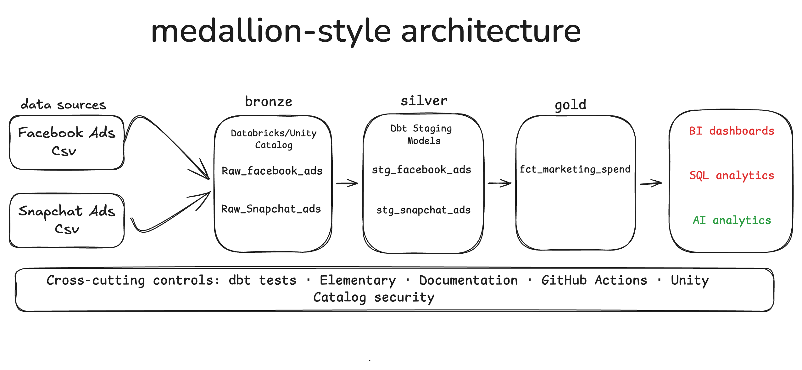

# Databricks-DBT Marketing Ads Project

## Overview

This project uses dbt (data build tool) and Databricks to transform and model marketing advertising data from Facebook Ads and Snapchat Ads.

The project implements a multi-layer data transformation pipeline, moving data from raw source tables through staging and intermediate models into marts for downstream analytics and reporting.

It also incorporates data quality testing and monitoring using dbt tests and Elementary Data (EDR) reports.

## Technologies

- **Databricks** — data platform for storing and processing data
- **dbt** — SQL-based data transformation, testing, and modelling
- **Elementary Data (EDR)** — data quality monitoring and reporting
- **SQL and Jinja** — data transformation and reusable SQL logic
- **Python and uv** — project environment and dependency management
- **Git and GitHub** — version control and collaboration

## Pipeline Architecture

The project follows a layered data modelling approach:

1. **Raw Layer** — Facebook Ads and Snapchat Ads source data is loaded into Databricks tables.
2. **Staging Layer** — raw data is cleaned, cast to appropriate data types, and standardised.
3. **Intermediate Layer** — staging models are combined and transformed into more meaningful datasets.
4. **Mart Layer** — curated datasets are prepared for downstream analytics, business intelligence, and reporting.

### Pipeline Diagram

The pipeline architecture diagram is available below.




## Project Structure

```text
models/
├── staging/
│   ├── facebook/
│   └── snapchat/
├── intermediate/
└── marts/

docs/
└── marketing_ads_pipeline.png

elementary_report.html
```

The staging, intermediate, and mart directories contain the SQL models and YAML configuration files used for transformation, documentation, and data quality tests.

The `docs/` directory contains the pipeline architecture diagram. The `elementary_report.html` file contains the generated HTML report, provided it is saved at the project root.

## Data Quality and Testing

The project uses dbt data tests to validate model reliability and identify potential data quality issues.

Tests include:

- `not_null` — checks that required fields do not contain null values.
- `unique` — checks that fields expected to be unique contain no duplicates.
- Additional package-based tests where appropriate.

Tests are configured according to the grain of each model. For example, advertising statistics may contain multiple records for the same ad across reporting dates, so the ad identifier alone may not be unique.

## Elementary Data (EDR) Reporting

Elementary Data is used to support data quality monitoring and reporting for the dbt project.

The generated EDR HTML report provides a consolidated view of available test results and data quality information.

The report is saved as:

```text
elementary_report.html
```

Open the HTML file in a web browser to review the report. The file can also be committed to GitHub if you want the report stored alongside the project, provided it contains no sensitive information.

## Running the Project

After configuring the Databricks connection and dbt profile, run the following commands from the project directory.

Install dbt packages:

```bash
uv run dbt deps
```

Check the Databricks connection:

```bash
uv run dbt debug --profiles-dir .
```

Validate the project configuration:

```bash
uv run dbt parse
```

Build models and run applicable tests:

```bash
uv run dbt build
```

Generate dbt documentation artifacts:

```bash
uv run dbt docs generate
```

## Generating the EDR Report

Generate the Elementary report using:

```bash
uv run edr report \
  --project-dir . \
  --profiles-dir . \
  --profile-target dev \
  --project-profile-target dev \
  --file-path ./elementary_report.html \
  --open-browser false
```

This command saves the HTML report to `elementary_report.html` in the current project directory, assuming the command completes successfully.

## Security

- Store Databricks credentials in environment variables rather than hardcoding them in project files.
- Do not commit access tokens, passwords, client secrets, or `.env` files.
- Review generated reports before publishing them to GitHub, as they may contain internal table names, test results, or other sensitive metadata.
